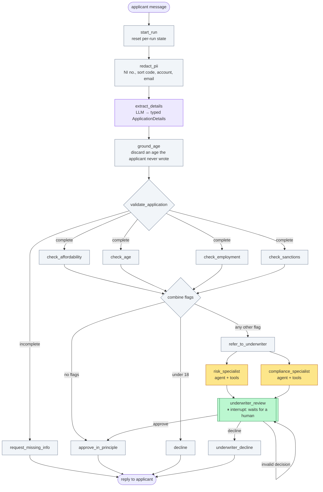
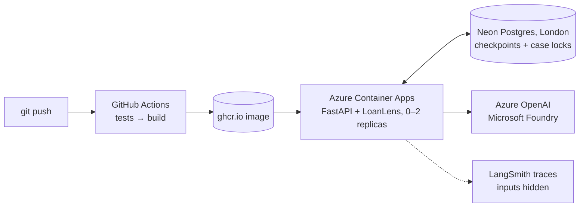

# LoanLens

**An agentic loan-underwriting copilot for UK consumer lending, built with LangGraph.**

[](https://github.com/NaveenManjappa/loanlens/actions/workflows/publish-image.yml)

LoanLens takes a loan application written in plain English, keeps personal data away from the model,
extracts the details, screens them against policy, and either approves in principle, declines, asks for
missing information, or refers the case to a **human underwriter**. Specialist AI agents prepare a risk
and compliance report for the underwriter. The design follows one rule throughout: **the model only does
what needs judgement; anything deterministic is plain code; every "maybe" goes to a person; and the only
automatic "no" is a hard legal rule (applicants must be 18 or over).**

```
"Hi, I'm Priya, 34, a nurse on £42,000. I'd like £8,000 for a car."   → approved in principle
"Tom Reid, plumber, about £60k, looking for £8,000."                    → "To continue, we need: age."
"Sam Jones, 29, self-employed, about £40k, want £5,000."                → referred → specialists report
                                                                           → underwriter approves/declines
"Ivan Petrov, 45, employed, £70k, want £10,000."                        → sanctions match → referred to a human
```

## Architecture

### The graph

A **workflow with agents inside it**, not one free-roaming agent. The diagram below follows the graph that
`build_graph()` compiles (`graph.get_graph().draw_mermaid()`), redrawn with labels and colours:



| Colour | Kind of step | Examples |
|---|---|---|
| Purple | One LLM call with **structured output** | `extract_details` |
| Amber | **Agents**: a model choosing tools in a loop, with call limits | risk and compliance specialists |
| Green | **Human-in-the-loop**: the graph pauses until an underwriter decides | `underwriter_review` |
| Grey | **Plain code**: deterministic, testable, auditable | PII redaction, policy checks, sanctions, routing |

### The deployment



Replicas are disposable: every case lives in Postgres (a LangGraph checkpointer keyed by `thread_id`), so
any replica can continue any case after a restart, a redeploy or a scale-to-zero.

## Design decisions

| Decision | Why |
|---|---|
| **Workflow first, agents only where judgement is needed** | Policy rules, routing and sanctions screening are deterministic; making them agentic would make them slower, costlier and less auditable. The agents only *prepare reports* for a human. |
| **Redact PII at the boundary, before anything is stored** | NI numbers, sort codes, account numbers and emails are replaced before the first checkpoint and before any model call (UK GDPR data minimisation). Agent tool results are redacted too, via `PIIMiddleware`. |
| **Sanctions screening is plain code, run for every applicant** | It was first an agent tool that only ran on referrals, so a sanctioned applicant with no other flags was auto-approved. The eval suite caught it; it's now a fourth parallel check, and a match always goes to a human (name matches can be false positives). |
| **Evaluator → guard** | The `age_not_invented` evaluator measures how often the model invents an age; the same rule runs inside the graph (`ground_age`), so an invented age is discarded and the applicant is asked instead. |
| **Human review with `interrupt()`** | Referred cases pause at `underwriter_review` until a named underwriter submits a decision and a reason, so significant decisions get human review (the concern behind UK GDPR Article 22). New applicant messages during review are held for the underwriter rather than restarting the case ([ADR 0001](docs/decisions/0001-underwriter-rescreen.md)). |
| **Specialists get private context** | Each specialist agent runs as a subgraph inside a node with only the redacted application, not the conversation; their reports merge into state through a custom reducer. |
| **Content filtering by the provider, failures handled in code** | Azure's content filter blocks harmful prompts; LoanLens catches the block, withholds the message from the case and replies calmly, so a case never gets stuck ([ADR 0002](docs/decisions/0002-content-safety-provider-filter.md)). |
| **One run per case at a time** | A per-case lock (a Postgres advisory lock across replicas) answers `409` to a concurrent request, preventing lost updates from double-clicks. |

## Evaluation

`scripts/run_evals.py` runs 9 labelled cases through the **real** model several times and reports pass
rates and cost. Four evaluators (`src/loanlens/evals.py`):

| Evaluator | Type | Bar |
|---|---|---|
| `outcome_matches` | reference-based | critical for the sanctions case (100%), a tracked rate otherwise |
| `no_raw_pii_sent_to_models` | invariant: scans **every** prompt, including inside agents | 100% |
| `age_not_invented` | reference-free grounding check (also usable on live traffic) | 100% |
| `extraction_correct` | reference-based (e.g. monthly salary → annual) | tracked rate |

Results on a `gpt-5` deployment, 9 cases × 2 repeats on the current code (November 2026):

| Evaluator | Pass rate |
|---|---|
| `outcome_matches` | 100% (18/18), including the sanctioned applicant referred in both runs |
| `no_raw_pii_sent_to_models` | 100% |
| `age_not_invented` | 100% |
| `extraction_correct` | 100% |

Cost per case: about 620–910 tokens and 1 model call for an application that doesn't need review;
3.9k–6.2k tokens and 5–6 calls for a referred one, where the specialist agents dominate.

**The bug this caught.** Before the sanctions fix, the sanctioned applicant was **approved** in both runs, after
a single model call: only the extractor ever saw him. Sanctions screening lived inside the compliance agent, which
only runs on referred cases. It is now a plain-code check that runs for every application.

**And one it's tracking.** An earlier run showed an inconsistency: given only a job title ("nurse"), the model
sometimes inferred "employed" and sometimes didn't. That's now an explicit policy in the extraction prompt: the
employment status is set only when stated or clearly implied, otherwise LoanLens asks. The `job-title-only`
case tests it.

The unit-test suite (150+ tests) uses fake models only, so it's free, deterministic and runs in CI on every push.

## Run it locally

Requires [uv](https://docs.astral.sh/uv/) and an Azure OpenAI deployment.

```bash
uv sync
cp .env.example .env                 # add your Azure OpenAI endpoint, key and deployment name
uv run pytest                        # the full suite, with fake models (no API calls)
uv run uvicorn loanlens.main:app --reload
```

Open `http://127.0.0.1:8000/docs` for the interactive API. Locally, cases are kept in a SQLite file; set
`DATABASE_URL` to use Postgres.

| Endpoint | Purpose |
|---|---|
| `POST /cases/{case_id}/messages` | An applicant sends a message; returns the outcome and LoanLens's reply |
| `GET /cases/{case_id}` | Read a case (runs nothing) |
| `GET /cases/{case_id}/review` | What the underwriter sees for a paused case |
| `POST /cases/{case_id}/decision` | The underwriter approves or declines, with a reason and their id |
| `GET /health` | Health probe |

Real-model evals: `uv run python scripts/run_evals.py` (add `LANGSMITH_*` settings to `.env` for traces).
Deployment: [docs/deploy-azure.md](docs/deploy-azure.md).

## Project structure

```
src/loanlens/
  pipeline.py        the graph: state, nodes, routing, build_graph()
  pii.py             boundary redaction + PIIMiddleware for agents
  extraction.py      LLM extraction into a typed Pydantic schema
  grounding.py       the age guard (shared with the evaluator)
  intake.py          validation        screening.py   policy checks + sanctions
  specialists.py     specialist agents as nodes; merge reducer
  investigator_v2.py risk agent (create_agent + middleware)    compliance.py   compliance agent
  underwriting.py    human review (interrupt / resume), holding messages during review
  cases.py           a case = a thread: continue, inspect, content-filter recovery
  evals.py           eval runner and evaluators
  api.py · main.py   FastAPI app       checkpointing.py · locks.py   Postgres/SQLite + case locks
tests/               one spec file per feature, fake models only
evals/dataset.json   labelled eval cases
docs/                ADRs and the Azure runbook
```

## Known gaps

This is a portfolio system, not a production lender. What's deliberately not done yet:

- **Authentication:** anyone with the URL can act as an underwriter. Planned: Microsoft Entra ID, with the underwriter's identity taken from the login ([ADR 0004](docs/decisions/0004-authentication-entra-id.md)).
- **Idempotency keys:** a concurrent request is rejected (`409`), but a retried request should get the first answer back. Planned: an `Idempotency-Key` header ([ADR 0003](docs/decisions/0003-idempotency-keys.md)).
- **No UI:** the API is the only interface. Planned: an applicant chat and an underwriter review queue ([ADR 0005](docs/decisions/0005-ui-and-review-queue.md)).
- **Vulnerable customers (Consumer Duty):** vulnerability markers are only checked on referred cases; the content filter is not a vulnerability detector.
- **Automated declines:** under-18 applications are declined without a human. That's a legal-capacity rule, but production would still need Article 22 safeguards: telling the applicant, and offering human review on request.
- **Employment status from a job title:** the policy above is a prompt rule, and a stricter live test
  (`tests/test_extraction.py`) shows the model still occasionally infers "employed" from "teacher". A code
  guard, like the one for invented ages, would make it watertight.
- **Audit log:** decisions live in checkpoints; production needs an append-only, access-controlled audit store.
- **Keyless model access** (managed identity), private networking, a data-processing agreement for the database provider, and alerts on error rates and eval scores.

## Tech stack

LangGraph · LangChain (`create_agent`, middleware) · Azure OpenAI (Microsoft Foundry) · Pydantic ·
FastAPI · PostgreSQL (Neon) / SQLite checkpointers · pytest · LangSmith · Docker · GitHub Actions ·
Azure Container Apps
