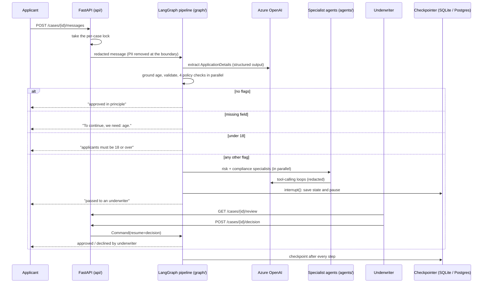

# 🏦 LoanLens: System Overview

LoanLens is an agentic loan-underwriting copilot for UK consumer lending, built with **LangGraph**. An applicant
describes their loan in plain English; LoanLens keeps their personal data away from the model, extracts the
details into a typed form, screens them against lending policy, and then does one of four things:

| Outcome | When | Who decides |
| :--- | :--- | :--- |
| `approved_in_principle` | Every policy check passes | Code |
| `awaiting_information` | A required detail is missing (or the model invented it) | Code asks the applicant |
| `declined` | The applicant is under 18 (a legal-capacity rule) | Code |
| `referred` → `approved_in_principle` / `declined_by_underwriter` | Any other risk flag | **A named human underwriter**, helped by two AI specialists |

---

## 🌟 The one design rule

> **The model only does what needs judgement. Anything deterministic is plain code. Every "maybe" goes to a
> person. The only automatic "no" is a hard legal rule.**

Concretely:

- **One LLM call on the main path.** The model turns free text into an `ApplicationDetails` object. It never
  writes a reply to the applicant: every reply is a fixed template in code, so input can't make LoanLens *say*
  anything.
- **Policy is code.** Affordability, age, employment and sanctions checks are plain functions in
  `services/policy.py` and `integrations/compliance_registry.py`. They are fast, free, testable and auditable.
- **Agents only prepare reports.** The risk and compliance specialists run only on referred cases, and only
  write a memo for the underwriter. They never decide.
- **Humans decide the grey areas.** The graph pauses with `interrupt()` until an underwriter submits a decision,
  a reason and their id.

---

## 🏗️ High-level flow



---

## 🧱 Tech stack

| Concern | Choice |
| :--- | :--- |
| Orchestration | LangGraph `StateGraph` with a checkpointer and `interrupt()` |
| Agents | LangChain `create_agent` + middleware (PII, retries, tool errors, call limits) |
| Model | Azure OpenAI v1 API on Microsoft Foundry, via `ChatOpenAI` |
| API | FastAPI + Pydantic |
| Config | `pydantic-settings` |
| Storage | SQLite locally, Postgres (Neon) when deployed |
| Concurrency | In-process locks locally, Postgres advisory locks when deployed |
| Tracing | LangSmith (inputs hidden), Python `logging` |
| Quality | pytest with fake models, a real-model eval suite, ruff, GitHub Actions |
| Hosting | Docker image on ghcr.io → Azure Container Apps (0–2 replicas) |

---

## 📂 Repository layout

```
loanlens/
  src/loanlens/          the application (layers explained in 02_PROJECT_STRUCTURE.md)
  tests/                 mirrors src/loanlens/; fake models only
  evals/dataset.json     labelled cases for the real-model eval suite
  scripts/               run_evals.py, smoke_test.py
  docs/decisions/        ADRs 0001-0005
  docs/deploy-azure.md   the Azure runbook
  docs/guide/            this guide
  Dockerfile, Makefile, pyproject.toml, uv.lock
```

---

## 🚀 Quick navigation

| # | Guide | Read it when you want to… |
| :--- | :--- | :--- |
| 02 | [Project structure](02_PROJECT_STRUCTURE.md) | know where code goes, and why |
| 03 | [The pipeline](03_THE_PIPELINE.md) | follow a message through every node |
| 04 | [Specialist agents](04_SPECIALIST_AGENTS.md) | understand the risk and compliance agents and their tools |
| 05 | [Human in the loop](05_HUMAN_IN_THE_LOOP.md) | understand pausing, reviewing and resuming a case |
| 06 | [PII and safety](06_PII_AND_SAFETY.md) | see every guardrail and where it runs |
| 07 | [API reference](07_API_REFERENCE.md) | call the API |
| 08 | [Persistence and concurrency](08_PERSISTENCE_AND_CONCURRENCY.md) | understand cases, checkpoints and locks |
| 09 | [Environment variables](09_ENVIRONMENT_VARIABLES.md) | configure LoanLens |
| 10 | [Testing](10_TESTING.md) | write or run tests |
| 11 | [Evals](11_EVALS.md) | measure the real model |
| 12 | [Tracing and observability](12_TRACING_AND_OBSERVABILITY.md) | see what happened in a run |
| 13 | [Running and deploying](13_RUNNING_AND_DEPLOYING.md) | run locally or ship to Azure |
| 14 | [Known gotchas](14_KNOWN_GOTCHAS.md) | avoid the non-obvious traps |
| 15 | [Known gaps and roadmap](15_KNOWN_GAPS_AND_ROADMAP.md) | know what is not production-ready yet |
