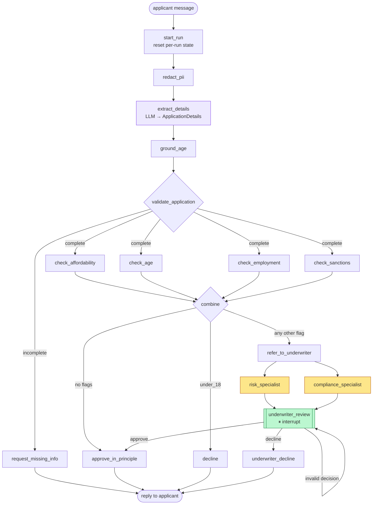

# 🧠 The Pipeline: Following a Message Through the Graph

LoanLens is a **workflow with agents inside it**, not one free-roaming agent. The graph is a LangGraph
`StateGraph` compiled by `build_graph()` in `graph/pipeline.py`. Every applicant message starts one **run** of
this graph, and the checkpointer saves the state after every step.

---

## ⛓️ The graph



Purple is one LLM call, amber is an agent loop, green is a human. Everything else is plain code.

---

## 💾 The state: `PipelineState`

Defined in `graph/state.py`. It extends LangGraph's `MessagesState` (which brings `messages` and its
`add_messages` reducer) and sets `total=False`, so every key is optional.

| Key | Type | Written by | Notes |
| :--- | :--- | :--- | :--- |
| `messages` | list of messages | boundary, `redact_pii`, outcome nodes | Reducer `add_messages`: appends, or **replaces** a message with the same id |
| `application` | dict | `extract_details`, `ground_age` | The redacted `ApplicationDetails` as a plain dict |
| `missing_fields` | list[str] | `validate_application` | In `REQUIRED_FIELDS` order |
| `is_complete` | bool | `validate_application` | Drives the first fork |
| `risk_flags` | list[str] | the four checks | Reducer `operator.add`: parallel checks **append** |
| `outcome` | str | `start_run` and outcome nodes | `in_progress`, `awaiting_information`, `declined`, `referred`, `approved_in_principle`, `declined_by_underwriter` |
| `specialist_reports` | dict | specialist nodes | Reducer `merge_reports`: parallel reports **merge** by name |
| `underwriter_decision` | dict | `underwriter_review` | The validated decision |
| `review_error` | str or None | `underwriter_review` | Set when a decision is invalid; loops back to review |
| `held_messages` | list[str] | `hold_for_underwriter` | Reducer `add`: messages received during review (ADR 0001) |

*Why reducers?* Four checks run in the **same step** and all write `risk_flags`. Without a reducer, LangGraph
would raise an error for concurrent writes to one key; with `add`, their lists are concatenated.

---

## 🤖 The nodes, step by step

### 1. 🔄 `start_run` (`graph/pipeline.py`)
Resets the per-run keys: `risk_flags`, `held_messages` and `specialist_reports` to empty, and `outcome` to
`in_progress`. The conversation (`messages`) is kept, so the next run sees everything the applicant has said.

*Gotcha:* keys with a reducer are reset with `Overwrite([])`. A plain `[]` would be **added** to the old list
by the reducer, not replace it.

### 2. 🧽 `redact_pii` (`graph/intake.py`)
Replaces each human message that contains PII with a redacted copy **with the same id**, so `add_messages`
replaces the original instead of appending. Defence in depth: `graph/cases.py` already redacted the text before
it entered the graph. See [06](06_PII_AND_SAFETY.md).

### 3. 📝 `extract_details` (`graph/intake.py`)
The **only LLM call on the main path**. `make_extract_node(model)` wraps the model with
`with_structured_output(ApplicationDetails)` and sends the extraction prompt (`prompts/extraction.md`) plus
**the whole conversation**. That's how a second message ("I'm 41") completes an application started in the first.

`ApplicationDetails` (`domain/application.py`) has five fields, all defaulting to `None`:

| Field | Type |
| :--- | :--- |
| `applicant_name` | `str` |
| `age` | `int` |
| `loan_amount` | `float` (GBP) |
| `annual_income` | `float` (GBP per year; the prompt says to multiply a monthly figure by 12) |
| `employment_status` | `employed`, `student`, `self_employed`, `unemployed`, `retired` |

*Why all optional?* If the applicant didn't say it, we want `None`, not a guess. Validation then asks for it.
The prompt also forbids inferring employment status from a job title alone ("nurse" stays `None`).

### 4. ⚓ `ground_age` (`graph/intake.py`)
If the extracted age doesn't appear as a standalone number in anything the **applicant** wrote, it is set back
to `None`, and validation asks for it. The rule (`services/grounding.age_in_text`) is shared with the
`age_not_invented` evaluator. It accepts "I'm 34" but not "aged 134", "£34,000" or "34.5k".

### 5. ✅ `validate_application` (`graph/screening.py`)
Lists the required fields that are missing (`services/policy.missing_fields`). The router
`route_after_validation` then goes to `request_missing_info`, or **fans out** to all four checks at once by
returning the list `SCREENING_CHECKS`.

### 6. 🔍 The four screening checks (`graph/screening.py`, rules in `services/policy.py`)

| Node | Flag | Rule |
| :--- | :--- | :--- |
| `check_affordability` | `high_loan_to_income` | loan > 50% of annual income (`MAX_LOAN_TO_INCOME = 0.5`), or income ≤ 0 |
| `check_age` | `under_18` | age < 18 (`MIN_AGE`) |
| `check_employment` | `no_employment_income` / `self_employed_needs_review` | unemployed / self-employed |
| `check_sanctions` | `sanctions_match` | name on the sanctions list (`integrations/compliance_registry.is_sanctioned`) |

### 7. 🔗 `combine`
An empty join node. It runs once all four checks have finished, so the router sees **every** flag.
`route_after_screening` then decides:

1. `under_18` in flags → `decline` (never lend to minors; checked first, so it wins over other flags)
2. any other flag → `refer_to_underwriter`
3. no flags → `approve_in_principle`

### 8. 📣 Outcome nodes
`request_missing_info`, `decline`, `refer_to_underwriter`, `approve_in_principle` and `underwriter_decline` each
set `outcome` and append a **fixed** `AIMessage`. The model never writes customer-facing text.

### 9. 🕵️ Specialists and review
On a referral, the specialist nodes run in parallel, then the graph pauses at `underwriter_review`. See
[04](04_SPECIALIST_AGENTS.md) and [05](05_HUMAN_IN_THE_LOOP.md).

---

## 🔌 Dependency injection in `build_graph()`

```python
build_graph(model, checkpointer=None, specialists=None)
```

| Argument | Production (`main.py`) | Tests |
| :--- | :--- | :--- |
| `model` | `get_model(settings)` | a fake structured-output model |
| `checkpointer` | `SqliteSaver` or `PostgresSaver` | `InMemorySaver()` or `None` |
| `specialists` | `default_specialists(model)` | usually `None`: `refer_to_underwriter` goes straight to review |

*Why?* The graph never constructs its own dependencies, so every test runs the real graph with fakes, offline
and free.

---

## 🔢 Cost per case

From the eval suite on a `gpt-5` deployment (November 2026):

| Case type | Model calls | Tokens |
| :--- | :--- | :--- |
| Not referred | 1 | ~620–910 |
| Referred (with specialists) | 5–6 | ~3.9k–6.2k |
