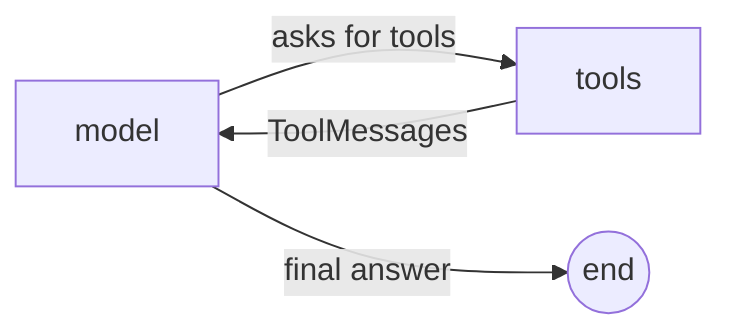

# 🕵️ Specialist Agents: Risk and Compliance

When a case is referred, two **agents** prepare reports for the underwriter. They run in parallel, each in its
own private context, and each produces a one-line verdict and a short memo. **They never decide the case.** The
underwriter does.

An *agent* here means a model that calls tools in a loop until it can answer. Both are built with LangChain's
`create_agent`, which compiles a small LangGraph graph of its own:



The model never runs a tool itself: it *asks* for one, the agent runs it and hands back a `ToolMessage`.

---

## 📊 Risk specialist (`agents/risk_agent.py`)

**Job:** investigate whether the applicant can afford the loan, and recommend `APPROVE`, `DECLINE` or
`REFER TO SENIOR UNDERWRITER`, with 2–4 bullet points of evidence.

### Tools (`tools/risk_tools.py`)

| Tool | Backed by | Returns |
| :--- | :--- | :--- |
| `lookup_credit_file(applicant_name)` | `integrations/credit_bureau.get_credit_file` | `credit_score`, `missed_payments_12m`, `existing_monthly_debt` (and, for some files, bank details the model must never see) |
| `verify_self_employed_income(applicant_name)` | `integrations/credit_bureau.get_verified_self_employed_income` | Verified income for the last two tax years |
| `calculate_affordability(annual_income, existing_monthly_debt, loan_amount, term_months=36)` | `services/policy.debt_to_income` | `monthly_repayment`, `debt_to_income`, `affordable` (ratio ≤ 0.4) |

Each tool's **docstring is the description the model reads**, so docstrings are written for the model.
A tool that finds nothing returns `{"error": ...}`: the model reads failure as data instead of crashing the loop.

*Why is the maths a tool?* Numbers come from code, never from the model. `calculate_affordability` is a thin
wrapper over a plain function the tests can call directly.

### Middleware (the guardrails)

```python
middleware=[
    *pii_middleware(),                          # redact PII in model input AND tool results
    ToolErrorMiddleware(on_error=on_tool_error),
    ToolRetryMiddleware(max_retries=2, retry_on=(ConnectionError, TimeoutError), ...),
    ModelCallLimitMiddleware(run_limit=6, exit_behavior="end"),
]
```

| Middleware | What it does | Why |
| :--- | :--- | :--- |
| `PIIMiddleware` × 4 | Redacts NI numbers, sort codes, account numbers and emails, including in **tool results** | The bureau returns bank details |
| `ToolRetryMiddleware` | Retries transient failures twice with backoff | A network blip shouldn't cost a verdict |
| `ToolErrorMiddleware` | After retries run out, turns the failure into a message: "`lookup_credit_file` is unavailable right now (TimeoutError). Do not guess its data." | The model can say so instead of the run crashing. Only the exception **type** is shown, never its text |
| `ModelCallLimitMiddleware` | At most 6 model calls (5 tool rounds + an answer), then stop | Bounds cost and runaway loops |

*Order matters:* retries sit **inside** error handling, so only the final failure reaches `on_tool_error`.
Non-transient errors (`on_tool_error` returns `None`) still raise: those are bugs, not outages.

### `risk_verdict`: policy applied in code

After the agent finishes, `risk_verdict(messages)` reads its conversation:

1. If `lookup_credit_file` **failed** (a `ToolMessage` with `status="error"`), return
   `REFER TO SENIOR UNDERWRITER`, whatever the model said. *Never recommend approval without a credit check.*
2. If the final message is empty, also refer.
3. Otherwise, use the first line of the answer.

---

## ⚖️ Compliance specialist (`agents/compliance_agent.py`)

**Job:** check rules that apply regardless of creditworthiness. Replies `COMPLIANT`, `NEEDS REVIEW` or
`NOT COMPLIANT` with 1–3 bullet points. A sanctions match is always `NOT COMPLIANT`; any vulnerability marker
is `NEEDS REVIEW`.

| Tool (`tools/compliance_tools.py`) | Backed by |
| :--- | :--- |
| `check_sanctions_list(applicant_name)` | `integrations/compliance_registry.is_sanctioned` |
| `check_vulnerability_markers(applicant_name)` | `integrations/compliance_registry.vulnerability_markers` (Consumer Duty markers such as a bereavement) |

Middleware: PII redaction and a cap of **4** model calls. Its verdict is the first line of its answer
(`first_line` in `graph/specialists.py`).

*Note:* sanctions screening of **every** applicant is plain code in the main pipeline (`check_sanctions`).
The agent's tool repeats the check only so its report is complete. See the story in [11_EVALS.md](11_EVALS.md)
for why that matters.

---

## 🔒 Private context: agents as nodes (`graph/specialists.py`)

`make_specialist_node(name, agent, verdict)` turns a compiled agent into a pipeline node:

```python
private_input = {"messages": [make_request(state["application"])]}
result = agent.invoke(private_input, {"recursion_limit": 100})
report = {"verdict": verdict(messages), "memo": last message, "tools_used": [tool names]}
return {"specialist_reports": {name: report}}
```

- The agent sees **only** the redacted, extracted application as JSON, never the applicant's conversation.
  Its tool calls never touch the pipeline's `messages`.
- Each node returns `{"specialist_reports": {name: report}}`; the `merge_reports` reducer combines the two
  parallel writes into one dict.
- `default_specialists(model)` registers both: `{"risk": (agent, risk_verdict), "compliance": (agent, first_line)}`.
  Each becomes a node named `<name>_specialist`. Adding a third specialist is one entry here.

---

## 📝 Prompts live in files

| File | Used by |
| :--- | :--- |
| `prompts/extraction.md` | `graph/intake.EXTRACTION_PROMPT` |
| `prompts/risk_agent.md` | `agents/risk_agent.SYSTEM_PROMPT` |
| `prompts/compliance_agent.md` | `agents/compliance_agent.COMPLIANCE_PROMPT` |

`agents/prompts.load_prompt(name)` reads them with `importlib.resources`, so they're found inside the installed
package and the Docker image, from any working directory. `tests/agents/test_prompts.py` checks that the risk
prompt names the same `REFER` verdict the code falls back to, so the two can't drift apart.

---

## 🎭 The fake external systems

`integrations/credit_bureau.py` and `integrations/compliance_registry.py` hold canned data for the demo
applicants:

| Applicant | Credit file | Self-employed income | Sanctions | Vulnerability |
| :--- | :--- | :--- | :--- | :--- |
| Priya Shah | score 870, £150/month debt | – | no | – |
| Sam Jones | score 640, 2 missed payments, £450/month debt, **bank details** | £31,000 / £36,500 | no | – |
| Tom Reid | score 910, no debt | £58,000 / £61,000 | no | recent bereavement |
| Ivan Petrov | – | – | **yes** | – |

In production these modules would become HTTP clients (with timeouts and retries), and the tools wouldn't change.
