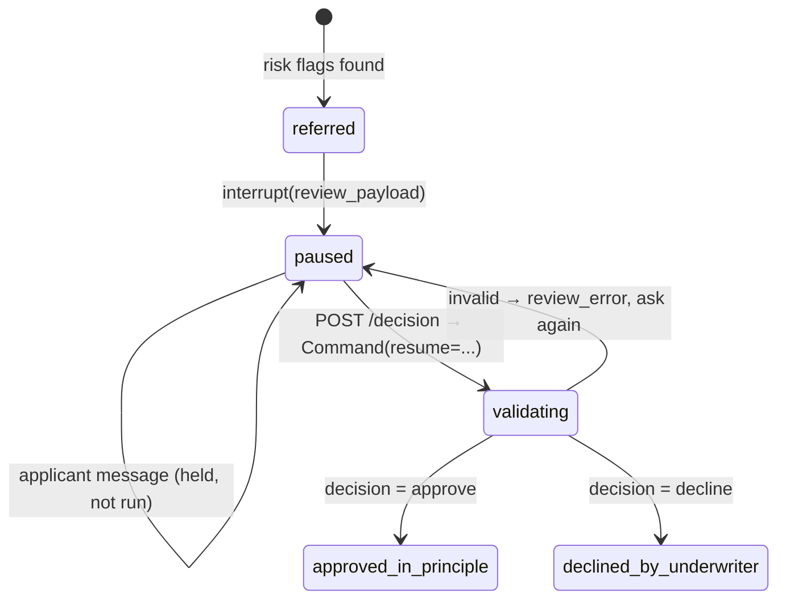

# 🧑‍⚖️ Human in the Loop: Pausing, Reviewing, Resuming

Every referred case waits for a **named underwriter**, who must give a decision, a reason and their id. Human
review is how LoanLens addresses the concern behind UK GDPR Article 22 (significant decisions made solely by
automated means).

---

## ⏸️ How the pause works

`underwriter_review` (`graph/underwriting.py`) calls LangGraph's `interrupt()`:

```python
def underwriter_review(state):
    decision = interrupt(review_payload(state))   # saves state and stops the run here
    error = validate_decision(decision)
    if error:
        return {"review_error": error}
    return {"underwriter_decision": decision, "review_error": None}
```

1. **First time through:** `interrupt()` saves a checkpoint and stops the run. The value passed to it (the
   review payload) is stored on the paused task.
2. **On resume:** the API invokes the graph with `Command(resume=decision)`. LangGraph re-runs
   `underwriter_review` **from its first line**, and this time `interrupt()` returns the decision.

*Gotcha:* because the node re-runs from the top, **nothing before `interrupt()` may have side effects** (no
emails, no database writes). They would happen twice.



---

## 📋 What the underwriter sees: `review_payload`

`GET /cases/{case_id}/review` returns:

```json
{
  "application": {"applicant_name": "Sam Jones", "age": 29, "annual_income": 40000.0,
                  "loan_amount": 5000.0, "employment_status": "self_employed"},
  "risk_flags": ["self_employed_needs_review"],
  "error": null,
  "applicant_updates": [],
  "specialist_reports": {
    "risk": {"verdict": "APPROVE", "memo": "APPROVE\n- ...", "tools_used": ["lookup_credit_file", "..."]},
    "compliance": {"verdict": "COMPLIANT", "memo": "COMPLIANT\n- ...", "tools_used": ["check_sanctions_list", "..."]}
  }
}
```

| Field | Meaning |
| :--- | :--- |
| `application` | The redacted, extracted application |
| `risk_flags` | Why the case was referred |
| `error` | Why the previous decision was rejected, if it was |
| `applicant_updates` | Messages the applicant sent while the review was pending |
| `specialist_reports` | Each agent's verdict, memo and the tools it used |

*Least exposure:* everything needed to decide, nothing more, and all of it JSON-serialisable.

---

## ✍️ Submitting a decision

`POST /cases/{case_id}/decision` with:

```json
{"decision": "approve", "reason": "Two years of accounts seen", "underwriter_id": "uw-1"}
```

Validation happens **twice**:

| Where | What | On failure |
| :--- | :--- | :--- |
| `api/schemas.DecisionIn` | `decision` is `approve`/`decline`, `reason` and `underwriter_id` non-empty | `422` before the graph runs |
| `services/decisions.validate_decision` | Same rules, inside the graph | `review_error` is set and `route_after_review` loops back to `underwriter_review`, which pauses again |

*Why twice?* The API check gives callers a clean `422`. The graph check means the graph is safe even if it is
resumed by something other than this API (a script, a future queue worker).

`route_after_review` then sends `approve` to `approve_in_principle` and `decline` to `underwriter_decline`.

---

## 📨 Messages that arrive during a review (ADR 0001)

**The bug this prevents:** originally a new applicant message on a paused case started a fresh run from
`START`, silently abandoning the review. If the new run found no flags, the applicant was approved **without any
underwriter**, so an applicant could skip review just by sending another message.

**Now:** `continue_application` (`graph/cases.py`) checks `awaiting_underwriter()` first. If a review is pending,
it calls `hold_for_underwriter()` instead of running the graph:

```python
graph.update_state(config, {"messages": [redacted], "held_messages": [redacted.content]})
```

The message is redacted, stored in the conversation and listed under `applicant_updates` for the underwriter.
Only the underwriter's decision moves the case forward.

*Gotcha:* `update_state` writes a new checkpoint whose tasks **no longer carry the interrupt marker**, but
`snapshot.next` is still `("underwriter_review",)`. That's why `awaiting_underwriter()` checks both, and
rebuilds the payload from state when the marker is gone.

**Designed, not built (ADR 0001 part 2):** a `rescreen` decision that re-runs screening with the held messages,
and always returns the case to a human afterwards.

---

## 🧾 The audit trail

`tests/helpers.decisions_made(graph, case_id)` walks `get_state_history()` and returns the outcome of every
**completed** run, oldest first, e.g. `["awaiting_information", "referred", "approved_in_principle"]`. In
production this belongs in an append-only audit store (see [15](15_KNOWN_GAPS_AND_ROADMAP.md)).
