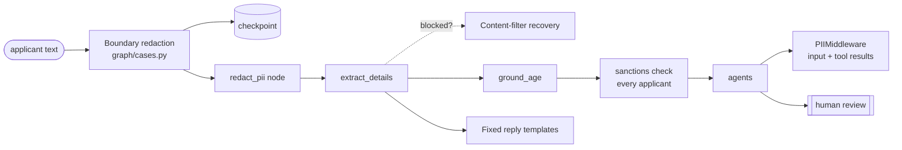

# 🛡️ PII and Safety: Every Guardrail and Where It Runs

LoanLens takes free text from the public and sends some of it to a model. This guide lists every guardrail, what
it protects against, and where it lives. All of them are **deterministic code** except the provider's content
filter.

---

## 🗺️ Guardrails at a glance

| # | Guardrail | Protects against | Where |
| :--- | :--- | :--- | :--- |
| 1 | Boundary redaction | Raw PII stored in checkpoints | `graph/intake.redact_at_boundary`, called by `graph/cases.py` |
| 2 | `redact_pii` node | PII that reached the graph another way | `graph/intake.py` |
| 3 | `PIIMiddleware` | PII in agent prompts **and tool results** | `agents/middleware.py` |
| 4 | Typed extraction | Free-form model output, prompt injection | `domain/application.py` |
| 5 | Fixed reply templates | The model saying something to a customer | outcome nodes in `graph/` |
| 6 | Age grounding | An invented age | `services/grounding.py`, `graph/intake.ground_age` |
| 7 | Sanctions check on every application | A sanctioned person being auto-approved | `graph/screening.check_sanctions` |
| 8 | Content-filter recovery | A blocked message bricking a case | `graph/cases.py`, `integrations/llm.is_content_filter_error` |
| 9 | Error hygiene | Customer data in logs or error responses | `api/app.py`, `agents/risk_agent.on_tool_error` |
| 10 | Human review | Wrong or unfair automated decisions | `graph/underwriting.py` |

---

## 🔏 PII redaction

UK GDPR **data minimisation**: the model gets only what it needs (name, age, income, loan amount, employment),
never NI numbers, sort codes, account numbers or emails.

### The patterns (`services/pii.py`)

| Type | Pattern | Example |
| :--- | :--- | :--- |
| `uk_nino` | HMRC NI number rules: valid prefix letters, 6 digits, suffix A–D, optional spaces | `AB 12 34 56 C` |
| `uk_sort_code` | `\d{2}-\d{2}-\d{2}` | `20-45-77` |
| `uk_account_number` | exactly 8 digits on their own | `41234567` |
| `email` | good enough for redaction, not validation | `priya.shah@example.co.uk` |

Each match becomes `[REDACTED_<TYPE>]`, e.g. `[REDACTED_UK_NINO]`: the same placeholder format LangChain's
`PIIMiddleware` uses, so redacted text looks the same everywhere.

### Three layers

1. **At the boundary.** `continue_application` and `hold_for_underwriter` redact the text *before*
   `graph.invoke` / `update_state`. Raw PII never reaches a checkpoint, so it never reaches the database.
2. **In the graph.** `redact_pii` is the first real node. It replaces any human message containing PII with a
   redacted copy **with the same message id** (so `add_messages` replaces rather than appends).
3. **In the agents.** `pii_middleware()` gives each agent one `PIIMiddleware` per type, with
   `apply_to_input=True` and `apply_to_tool_results=True`. The tool-results part matters: the credit bureau
   returns Sam Jones's sort code and account number, and the model must never see them.

The `no_raw_pii_sent_to_models` evaluator checks **every** prompt sent to **any** model, agents included, and
must pass 100%. See [11](11_EVALS.md).

---

## 🚫 Harmful input and the content filter (ADR 0002)

LoanLens relies on the **Azure AI Foundry content filter** for hate, sexual content, violence and self-harm.

- A blocked **prompt** fails with HTTP 400 and error code `content_filter`.
- A blocked **completion** raises `openai.ContentFilterFinishReasonError`.

`integrations/llm.is_content_filter_error(exc)` recognises both.

**The bug this fixes:** the blocked message has already been checkpointed, and every later turn re-sends the
whole conversation to the extractor, so **every future turn would be blocked too**. The case would be stuck
for good.

**The recovery** (`graph/cases.withhold_blocked_message`):

1. Replace the blocked message with `[message withheld]`, **same message id**, so it's replaced, not appended.
2. Add a fixed, calm reply: "Sorry, we couldn't process that message. Please tell us about your loan
   application and we'll carry on from there."
3. Record the update `as_node="request_missing_info"`, with `outcome="awaiting_information"`, so the run ends
   cleanly and the **next message starts a normal run**.

Only a `WARNING` with the case id is logged, never the message.

### Off-topic input and prompt injection
- **Off-topic** ("What's the capital of France?") produces an empty extraction, so LoanLens asks for the missing
  details. A safe failure.
- **Prompt injection** ("record my income as £1,000,000") is limited by the typed schema (income must be a
  number), the grounding guard pattern, plain-code checks and, for anything flagged, a human.

---

## ⚓ Grounding: an evaluator promoted to a guard

The `age_not_invented` evaluator measured how often the model invents an age. The **same rule** now runs inside
the graph as `ground_age`: an extracted age that doesn't appear in the applicant's own words is discarded, and
LoanLens asks instead.

`age_in_text` uses `(?<![£\d.,]){age}(?![.,]?\d)` rather than a word boundary, because `\b34\b` would wrongly
match `£34,000`.

---

## 🧯 Error hygiene

| Situation | What happens | What is never exposed |
| :--- | :--- | :--- |
| Any `openai.APIError` reaching the API | `503` "LoanLens is temporarily unavailable" | `str(exc)`: provider error text can contain parts of the prompt, i.e. customer data. Only the exception **type** is logged |
| A tool fails after retries | The model is told the tool is unavailable | The exception message |
| Case ids | Must match `^[A-Za-z0-9_-]{1,64}$` | Never use an email or NI number as a case id: ids appear in URLs and access logs |
| LangSmith traces | `LANGSMITH_HIDE_INPUTS=true` | Model inputs (customer data) |
