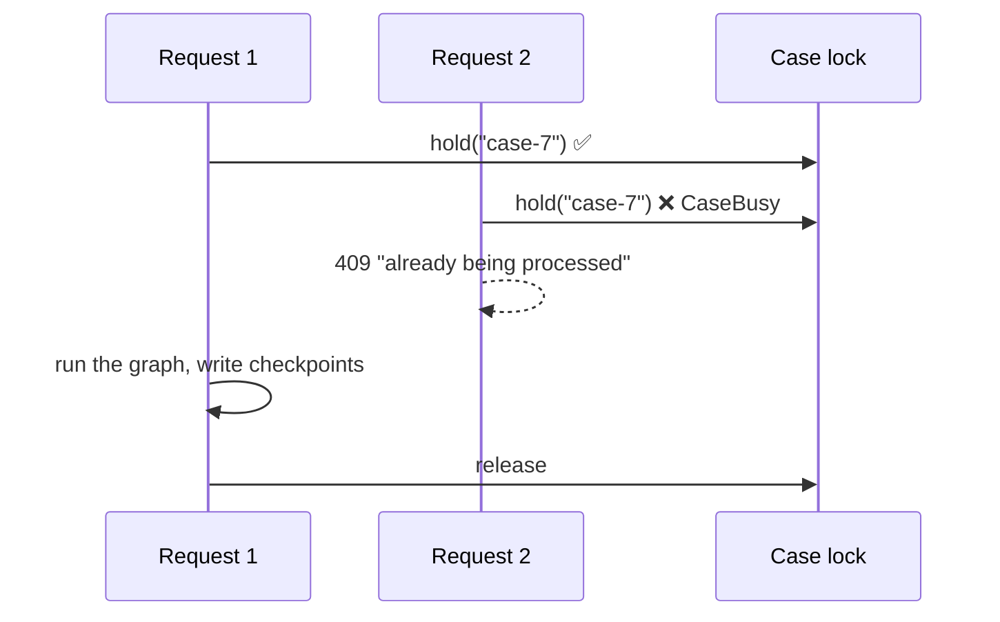

# 💾 Persistence and Concurrency: Cases, Checkpoints and Locks

---

## 🧵 A case is a LangGraph thread

Every message for the same applicant goes to the same `thread_id` (the `case_id`). LangGraph's **checkpointer**
saves a snapshot of the whole `PipelineState` after **every step**. The next message on that thread loads the
latest snapshot first, so it continues the case.

```python
thread_config(case_id) == {"configurable": {"thread_id": case_id}}
```

*Why it matters:* replicas are **disposable**. Every case lives in the database, so any replica can continue any
case after a restart, a redeploy or a scale-to-zero.

---

## 🗄️ Two backends (`integrations/storage.py`)

`open_backend(database_url, sqlite_path)` is a context manager that yields a `Backend(checkpointer, locks)` for
the app's lifetime and closes its connections afterwards.

| | Without `DATABASE_URL` | With `DATABASE_URL` |
| :--- | :--- | :--- |
| Checkpointer | `SqliteSaver` on `loanlens_cases.db` | `PostgresSaver` on a connection pool |
| Locks | `InProcessCaseLocks` | `PostgresCaseLocks` |
| Good for | local development, one process | Azure, several replicas |

### Postgres connection settings
The pool (`max_size=10`) is opened with what `PostgresSaver` requires:

| Setting | Why |
| :--- | :--- |
| `autocommit=True` | Each checkpoint write commits on its own |
| `row_factory=dict_row` | The checkpointer reads columns by name |
| `prepare_threshold=0` | No server-side prepared statements, which break behind poolers |

`saver.setup()` runs at startup to create the checkpoint tables. It is safe to repeat.

> On Neon, use the **direct** connection string (no `-pooler`), with `sslmode=require`.

---

## 🔐 One run per case at a time (`integrations/locks.py`)

**The problem:** two requests for the same case (a double-click, a retry) would both start from the same saved
state, and the last to finish would overwrite the other: a **lost update**.

**The fix:** before changing a case the API takes its lock. If it's already taken, `hold()` raises `CaseBusy`
immediately (no waiting) and the API answers `409`.



| Class | How | Notes |
| :--- | :--- | :--- |
| `InProcessCaseLocks` | One `threading.Lock` per case id, in a dict guarded by another lock | Only protects one process |
| `PostgresCaseLocks` | `SELECT pg_try_advisory_xact_lock(hashtextextended(case_id, 0))` in a transaction | Every replica asks the same database. The lock is **transaction-scoped**, so it is released automatically when the transaction ends, even if the app crashes or the connection drops. It can't leak |

Both expose the same `hold(case_id)` context manager, so the API doesn't know which it has.

---

## 🔁 Locks are not idempotency

The lock stops two requests running **at the same time**. It does nothing for the same request arriving
**again after the first finished** (a client retry after a timeout): that runs the graph a second time and pays
the model twice. The planned fix is an `Idempotency-Key` header; see
[ADR 0003](../decisions/0003-idempotency-keys.md).

---

## 🧪 Testing persistence

- Unit tests use `InMemorySaver()`.
- `tests/integrations/test_storage.py` checks that a case **survives a restart** on SQLite (a temp file), and on
  Postgres when `LOANLENS_PG_URL` is set:

```bash
LOANLENS_PG_URL='postgresql://...' uv run pytest tests/integrations/test_storage.py -v
```

- `tests/integrations/test_locks.py` checks `409` on concurrent requests, and the Postgres locks when
  `LOANLENS_PG_URL` is set.
