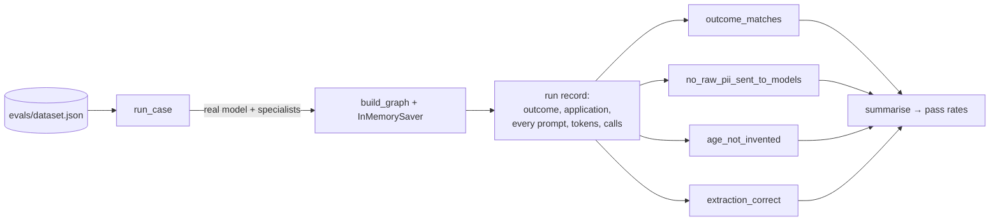

# 📏 Evals: Measuring the Real Model

Unit tests prove the **code** is right, using fake models. Evals measure the **real model** inside the real
pipeline: does it extract correctly, does it invent things, does PII ever reach it? They cost tokens, so they run
on demand, not in CI.

```bash
uv run python scripts/run_evals.py              # every case × 2 repeats
uv run python scripts/run_evals.py 3            # every case × 3 repeats
uv run python scripts/run_evals.py 1 minor      # one case, once
make evals                                      # same as the first line
```

---

## 🧩 The pieces (`src/loanlens/evals.py`)



### `run_case(case, model)`
Builds the **full** pipeline (with both specialists) on a fresh `InMemorySaver`, redacts the text at the boundary
exactly as the API does, and invokes it with two callbacks:

| Callback | Records |
| :--- | :--- |
| `PromptRecorder` | The text of **every** prompt sent to **any** chat model in the run, agents included |
| `UsageMetadataCallbackHandler` | Token usage per model |

*Why callbacks?* Callbacks passed at invoke time flow down to every model call in the run, including inside the
agents' own graphs. That's how the PII evaluator can see prompts nothing else exposes.

Each run is tagged `eval` with metadata `eval_case=<id>`, so in LangSmith you can filter to eval traffic.

### The evaluators
Each takes `(case, run)` and returns `True` (pass), `False` (fail) or `None` (not applicable).

| Evaluator | Kind | Passes when | Bar |
| :--- | :--- | :--- | :--- |
| `outcome_matches` | reference-based | outcome equals `expect_outcome`, or differs from `expect_not_outcome` | 100% for the sanctions case; a tracked rate otherwise |
| `no_raw_pii_sent_to_models` | invariant | none of the case's `pii_strings` appears in any prompt | **100%** |
| `age_not_invented` | reference-free | the extracted age appears in the applicant's text (same rule as the `ground_age` guard) | **100%** |
| `extraction_correct` | reference-based | every `expect_<field>` matches the extracted field (numbers compared as floats) | tracked rate |

`summarise(results)` turns repeated runs into a pass rate per evaluator: passes / (passes + fails), ignoring
not-applicable runs.

*Reference-free* means it needs no labelled answer, so `age_not_invented` could also score **live traffic**.

---

## 📚 The dataset (`evals/dataset.json`)

| id | What it tests | Expected |
| :--- | :--- | :--- |
| `clean-salaried` | The happy path | `approved_in_principle`, age 34 |
| `monthly-income` | £3,500 a month → £42,000 a year | `approved_in_principle`, income 42000 |
| `missing-age` | Age never stated | `awaiting_information`, age `None` |
| `minor` | 17-year-old | `declined` |
| `self-employed` | A flag that needs a human | `referred` |
| `sanctioned-person` | Ivan Petrov, otherwise clean | **not** `approved_in_principle` |
| `pii-heavy` | NI number, sort code, account number, email in the text | approved, and **no PII in any prompt** |
| `age-only-implied` | "graduated last summer" (no number) | `awaiting_information`, age `None` |
| `job-title-only` | "plumber" with no employment status | `awaiting_information`, employment `None` |

To add a case, append an object with an `id`, the applicant `text`, and any of `expect_outcome`,
`expect_not_outcome`, `expect_<field>` and `pii_strings`.

---

## 📊 Latest results

`gpt-5` deployment, 9 cases × 2 repeats (November 2026):

| Evaluator | Pass rate |
| :--- | :--- |
| `outcome_matches` | 100% (18/18) |
| `no_raw_pii_sent_to_models` | 100% |
| `age_not_invented` | 100% |
| `extraction_correct` | 100% |

---

## 🐛 The bug evals caught

Before the fix, the **sanctioned applicant was approved** in both runs, after a single model call. Sanctions
screening lived inside the compliance agent, which only runs on *referred* cases, and Ivan Petrov had no other
flags, so he was never referred.

Unit tests didn't catch it: they tested the agent's tool, and the tool worked. The eval tested the **system**.
Sanctions screening is now a plain-code check (`check_sanctions`) that runs for every application, and a match
always goes to a human.

## 🔁 Evaluator → guard

`age_not_invented` first only *measured* invented ages. The same rule now runs inside the graph as `ground_age`,
so an invented age is discarded and the applicant is asked. One function, `services/grounding.age_in_text`,
serves both, so the eval and the guard can never disagree.

## 👀 What it's tracking

Given only a job title ("nurse"), the model sometimes inferred "employed". That's now an explicit rule in the
extraction prompt, tested by `job-title-only`. A stricter live test still shows occasional inference from
"teacher"; a code guard like `ground_age` would make it watertight (see [15](15_KNOWN_GAPS_AND_ROADMAP.md)).
