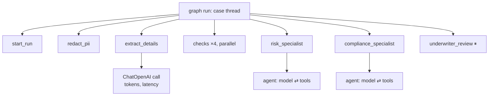

# 🔭 Tracing and Observability

Three sources tell you what happened, each at a different level.

| Source | Shows | Where |
| :--- | :--- | :--- |
| **Application logs** | Requests, startup, case outcomes, errors | stdout → terminal locally, Azure Log Stream when deployed |
| **LangSmith** | Inside the graph: every node, model call, tool call, token count and timing | smith.langchain.com |
| **Checkpoints** | The full state after every step of every case | SQLite / Postgres, via `graph.get_state_history()` |

---

## 📜 Application logs

`main.py` configures the standard `logging` module once:

```
%(asctime)s %(levelname)s %(name)s: %(message)s
```

The level comes from `LOG_LEVEL` (default `INFO`). Each module has its own `logger = logging.getLogger(__name__)`.

What gets logged:

| Level | Event | Module |
| :--- | :--- | :--- |
| `INFO` | Startup, and whether cases are stored in SQLite or Postgres | `main` |
| `INFO` | `case <id>: run finished with outcome <outcome>` | `graph.cases` |
| `INFO` | `case <id>: applicant message held for the underwriter` | `graph.cases` |
| `INFO` | `case <id>: underwriter <uw> submitted decision <decision>` | `graph.cases` |
| `INFO` | Case busy, `409` returned | `api.app` |
| `WARNING` | `case <id>: message blocked by the content filter and withheld` | `graph.cases` |
| `ERROR` | `model call failed (<ExceptionType>) on <method> <path>` | `api.app` |

**What is never logged:** message text, extracted details, or the text of a provider error (it can contain parts
of the prompt, i.e. customer data). Only ids, outcomes and exception **types**.

---

## 🕵️ LangSmith

Set the `LANGSMITH_*` variables ([09](09_ENVIRONMENT_VARIABLES.md)) and every graph run is traced. LangChain and
LangGraph send traces automatically; there is no tracing code in LoanLens.



- **Keep `LANGSMITH_HIDE_INPUTS=true`.** Inputs contain the (redacted) application; hiding them keeps customer
  data out of a third-party service.
- **Eval runs are tagged** `eval` with metadata `eval_case=<id>`, so you can filter them from real traffic.

---

## 🔍 Inspecting a case from its checkpoints

Every step of every case is saved, so you can replay a case's history in a Python shell:

```python
from loanlens.graph.cases import thread_config

for snapshot in graph.get_state_history(thread_config("demo-sam")):
    print(snapshot.next, snapshot.values.get("outcome"), snapshot.values.get("risk_flags"))
```

`snapshot.next` is the node about to run; `()` means a run finished. `tests/helpers.decisions_made()` uses
exactly this to build the audit trail of completed runs.

---

## 🖼️ Seeing the graph

```python
print(graph.get_graph().draw_mermaid())
```

The diagram in [03](03_THE_PIPELINE.md) and the README was redrawn from this output.

---

## 🧭 Observability without any service

The eval runner records every prompt and token count with LangChain **callbacks** (`PromptRecorder`,
`UsageMetadataCallbackHandler`), with no external service at all. The same technique works for ad-hoc debugging:
pass `{"callbacks": [handler]}` in the invoke config. See [11](11_EVALS.md).
