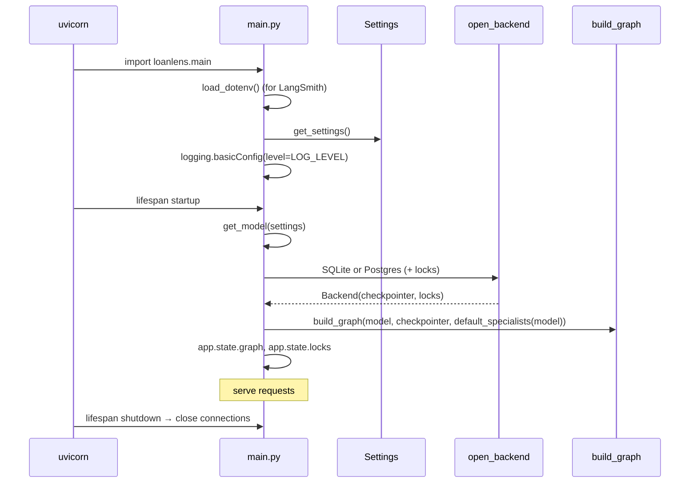
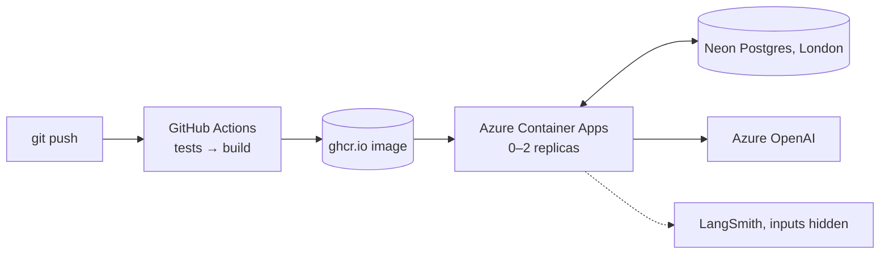

# 🚀 Running and Deploying

---

## 💻 Run it locally

Requires [uv](https://docs.astral.sh/uv/) and an Azure OpenAI deployment in Microsoft Foundry.

```bash
uv sync                              # install exactly what uv.lock lists
cp .env.example .env                 # add the endpoint, key and deployment name
make smoke                           # can LoanLens reach your model?
make check                           # format, lint, tests (fake models, no API calls)
make run                             # uvicorn loanlens.main:app --reload
```

Open <http://127.0.0.1:8000/docs> for the interactive API. Cases are stored in `loanlens_cases.db`; set
`DATABASE_URL` to use Postgres instead.

### Make targets

| Target | Runs |
| :--- | :--- |
| `make check` | `lint` then `test` |
| `make lint` | `ruff format .` and `ruff check .` |
| `make test` | `pytest -q` |
| `make run` | the API with auto-reload |
| `make evals` | the real-model eval suite (**costs tokens**) |
| `make smoke` | one real model call, with hints for common setup errors |

### `make smoke` troubleshooting

`scripts/smoke_test.py` matches the error text to a hint:

| Error contains | Meaning |
| :--- | :--- |
| `401` | Key rejected: re-copy the API key from Foundry |
| `DeploymentNotFound` / `404` | The deployment name must be the one **you** chose, exact case; the endpoint must end `/openai/v1/` |
| `Connection error` | Typo in the endpoint, or no internet |
| `429` | Rate limit or quota: wait, or raise the deployment's tokens-per-minute |

---

## 🔄 What happens at startup (`main.py`)



If a required Azure variable is missing, `get_model()` raises at startup with a message naming it, so a
misconfigured container fails fast instead of failing on the first request.

---

## 🐳 The Docker image

```dockerfile
FROM python:3.13-slim
COPY --from=ghcr.io/astral-sh/uv:0.11.32 /uv /bin/uv     # pinned uv: reproducible builds
COPY pyproject.toml uv.lock ./
RUN uv sync --frozen --no-dev --no-install-project       # dependency layer, cached until the lock changes
COPY src ./src
RUN uv sync --frozen --no-dev --no-editable              # the code (prompts/*.md included)
USER loanlens                                            # not root
CMD ["uvicorn", "loanlens.main:app", "--host", "0.0.0.0", "--port", "8000"]
```

`.dockerignore` keeps `.env` and `*.db` out of the image. It holds **no secrets**, which is why it can be public.

---

## ☁️ Deploying to Azure



1. **Push to `main`.** CI runs the tests; only if they pass does it build for `linux/amd64` and push
   `ghcr.io/<owner>/loanlens:<commit sha>` and `:latest`.
2. **Create the app once** with `az containerapp create`, passing the Azure OpenAI key and `DATABASE_URL` as
   secrets (`secretref:`), `--min-replicas 0 --max-replicas 2`.
3. **Redeploy** with `az containerapp update --image $IMAGE:$(git rev-parse HEAD)`, so you know exactly which
   commit is live. Each update creates a new revision.

The step-by-step commands, cost table and troubleshooting are in the **[Azure runbook](../deploy-azure.md)**.

### The durability test
Restart the app and read a case again: it's still there, because it lives in Neon, not in the container.

> ⚠️ **Demo only.** There is no authentication yet. Use made-up applicants only.
